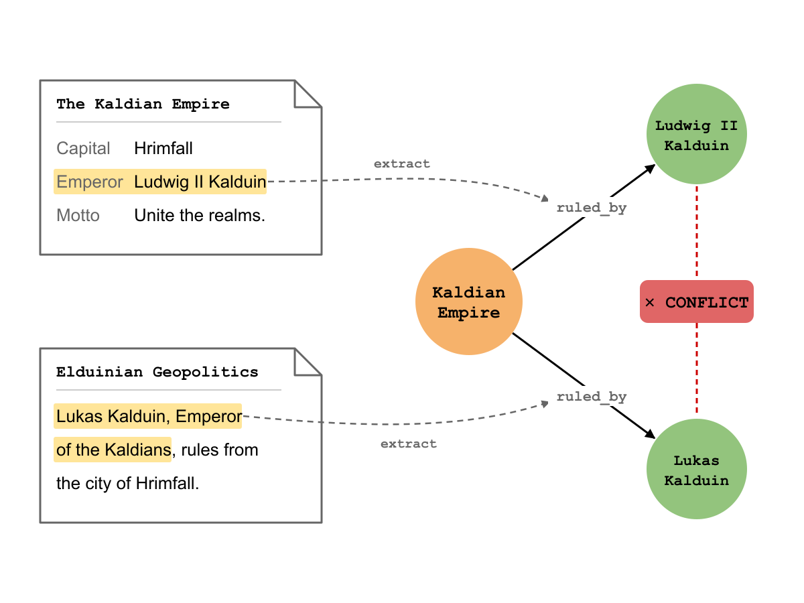
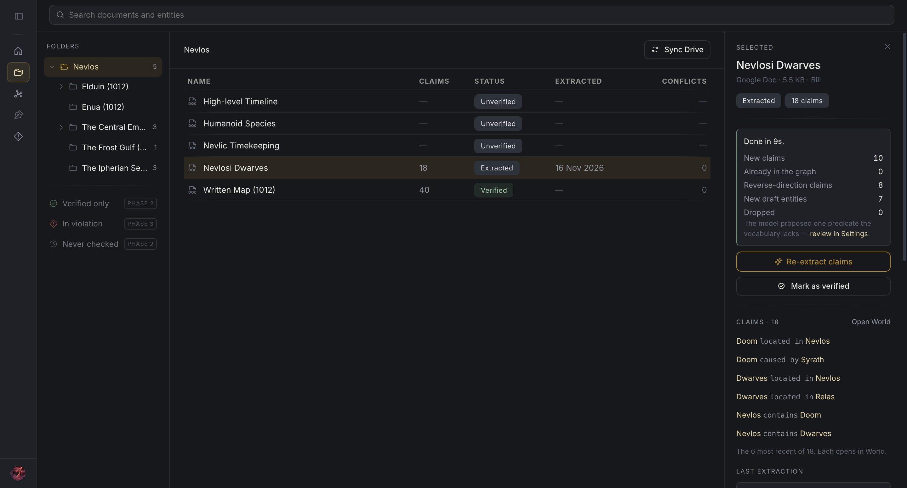
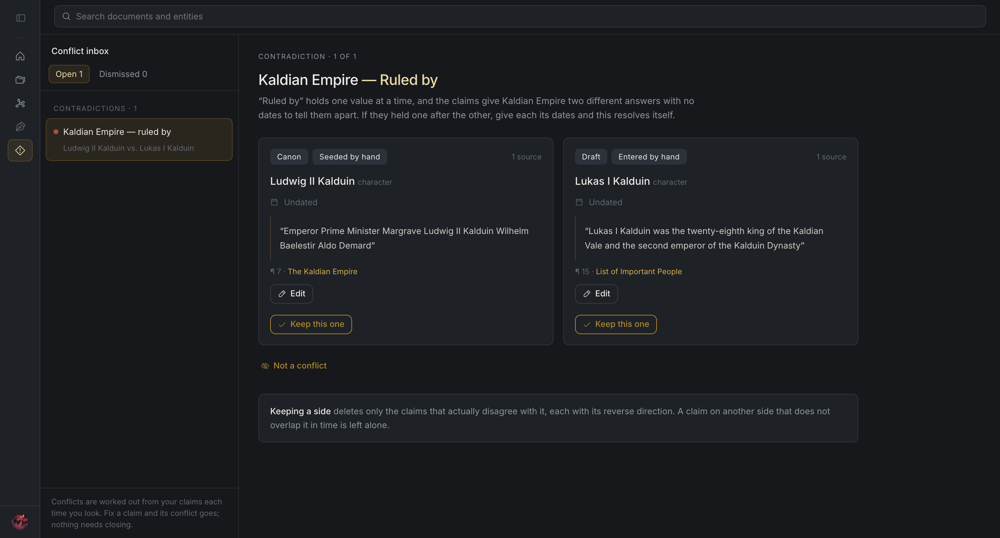

# Stone Brain

A continuity checker for worldbuilders. Stone Brain mirrors one Google Drive folder of documents
read-only, has a model extract every claim they make into a typed graph with verbatim citations,
and shows you where those claims contradict each other.



Two documents, written at different times, disagree about who rules the Kaldian Empire. Neither is
wrong on its own; together they are a continuity error. Stone Brain finds it by reading both into
the same graph.

## How it works

1. **Mirror.** The Library syncs the chosen Drive folder (`drive.readonly`; nothing is ever
   written to Drive), polling from the browser while the tab is visible. Documents removed from
   the folder are soft-deleted, so claims that cited them survive and are flagged
   (`src/lib/sync/`).
2. **Extract.** From a document's pane, Extract exports it as Markdown, sends its paragraphs to
   your model provider, and validates the reply against a closed ontology — entity types,
   predicates, domain and range — before anything is written (`src/lib/extraction/`,
   `src/lib/ontology/`). Every claim keeps its quote and paragraph anchor; every relationship has
   its reverse direction written beside it; names the graph does not know become draft entities.
   Each run is recorded with what it dropped and why, and predicates the vocabulary lacks are
   filed as proposals for review in Settings.

   

   When a document changes in Drive, the Library offers to re-extract it. A re-extraction reads
   the whole document again, but the model is also shown the claims already recorded from it.
   It leaves the ones that still hold alone, so unchanged text cannot drift, and retracts by
   name, with a reason, any the document no longer supports. A retraction never touches a claim
   a person wrote or promoted to canon, and every one is logged.
3. **Detect.** Conflicts are derived from the claims on every read, never stored: two claims
   giving a single-valued predicate different answers over overlapping time, a claim whose every
   source document has left the Library, or two entities whose names suggest they are one thing
   (`src/lib/conflicts/`, `src/lib/duplicates/`).
4. **Resolve.** The Conflicts screen sets the competing claims side by side with their evidence.
   Keep one side, edit a claim (often to add the dates that make two rulers a succession), merge
   two entities that turn out to be one, or dismiss the conflict — the only conflict state that
   is stored.

   

The other screens:

- **Home** — what needs attention: open conflicts, documents changed since they were extracted,
  and recent runs.
- **World** — the graph itself: every entity and claim, as a table or a force-directed picture,
  filterable by entity or by source document, with hand entry and editing.
- **Settings** — the model provider, and the queue of proposed predicates.

Signed out, `/` is a public page describing the app.

## Stack

Next.js 16 (App Router, Turbopack) and React 19, all TypeScript. Drizzle ORM on Neon Postgres,
where the ontology is enforced by foreign keys and check constraints, not only in code. Zod at
every boundary. Hand-rolled Google OAuth (`google-auth-library`, `jose`), with refresh tokens
encrypted at rest. Inference is bring-your-own: any OpenAI-compatible chat-completions endpoint,
configured per user in Settings (development uses Gemini). Vitest for tests, with PGlite running
the real migrations in-process for anything that is really about SQL.

## Running it locally

Needs Node 22+, a Neon database, and a Google OAuth client. The step-by-step walkthrough of the
one-time Google and Neon setup is [docs/phase-1-setup.md](docs/phase-1-setup.md).

```bash
npm install
cp .env.example .env.local   # then fill it in; src/lib/env.ts refuses to boot on a missing value
npm run db:migrate           # apply drizzle/ migrations
npm run db:seed              # load the ontology (entity types, predicates, signatures)
npm run dev                  # http://localhost:3000
```

`.env.local` needs:

- `DATABASE_URL` / `DATABASE_URL_UNPOOLED` — Neon's pooled and direct connection strings. The
  app runs on the pooler; drizzle-kit needs the direct one for DDL.
- `GOOGLE_CLIENT_ID` / `GOOGLE_CLIENT_SECRET` — a Web application OAuth client with the Drive API
  enabled and `${APP_URL}/api/auth/google/callback` as an authorized redirect URI, matching
  character for character. While the consent screen is in testing, add yourself as a test user.
- `APP_URL` — `http://localhost:3000` locally; no trailing slash.
- `SESSION_SECRET` and `TOKEN_ENC_KEY_V1` — each `openssl rand -base64 32`. Leave
  `TOKEN_ENC_ACTIVE` at `v1`.
- `SHOW_DOCUMENT_IDS` — optional, off by default; shows internal ids in the Library pane for
  debugging.

First run sends you to `/connect` to authorize Google, then to `/setup/folder` to pick the folder
to mirror. To extract, add a model provider in Settings.

## Scripts

| Script | What it does |
| --- | --- |
| `npm run dev` / `build` / `start` | Next dev server, production build, production server |
| `npm run typecheck` | `tsc --noEmit` |
| `npm test` | Vitest, once (`npm run test:watch` to watch) |
| `npm run lint` | ESLint (flat config: Next Core Web Vitals + typescript-eslint) |
| `npm run db:migrate` / `db:generate` / `db:studio` | Drizzle migrations and the Drizzle Studio browser |
| `npm run db:seed` | Load the ontology registry into the reference tables |
| `npm run db:seed:world` (and `:kaldia`, `:runar`) | Load hand-labelled ground truth for one corpus document. Needs `corpus/` |
| `npm run extract` | Extract one document from the command line (`--write` to store it, `--dump-prompt` to see what would be sent) |
| `npm run extract:capture` / `extract:score` | Capture extraction runs over the seeded documents and score them against the ground truth. Needs `corpus/` |
| `npm run db:backfill:inverses` | Materialise reverse-direction claims for rows written before that existed |

## Docs

- [docs/implementation-plan.md](docs/implementation-plan.md) — the phased build plan and its status
- [docs/architecture-decisions.md](docs/architecture-decisions.md) — decisions, with the reasoning and later corrections
- [docs/ontology-design.md](docs/ontology-design.md) — entity types, claim shapes, the matcher, inverses, and how the vocabulary grows
- [docs/extraction-scoring.md](docs/extraction-scoring.md) — how extraction is scored against hand-labelled ground truth
- [docs/calendar.md](docs/calendar.md) — how in-world dates are parsed and ordered
- [docs/deferred-proposals.md](docs/deferred-proposals.md) — vocabulary changes judged worth having and deferred
- [docs/phase-1-setup.md](docs/phase-1-setup.md) — one-time Neon and Google Cloud setup

`corpus/` is gitignored and holds private worldbuilding: the hand-seeded ground truth
(`corpus/seeds/`), the scripts that load it, and saved extraction runs. Scoring and the seed
scripts need it; the app, its tests and a fresh clone do not.

## License

MIT — see [LICENSE](LICENSE).
